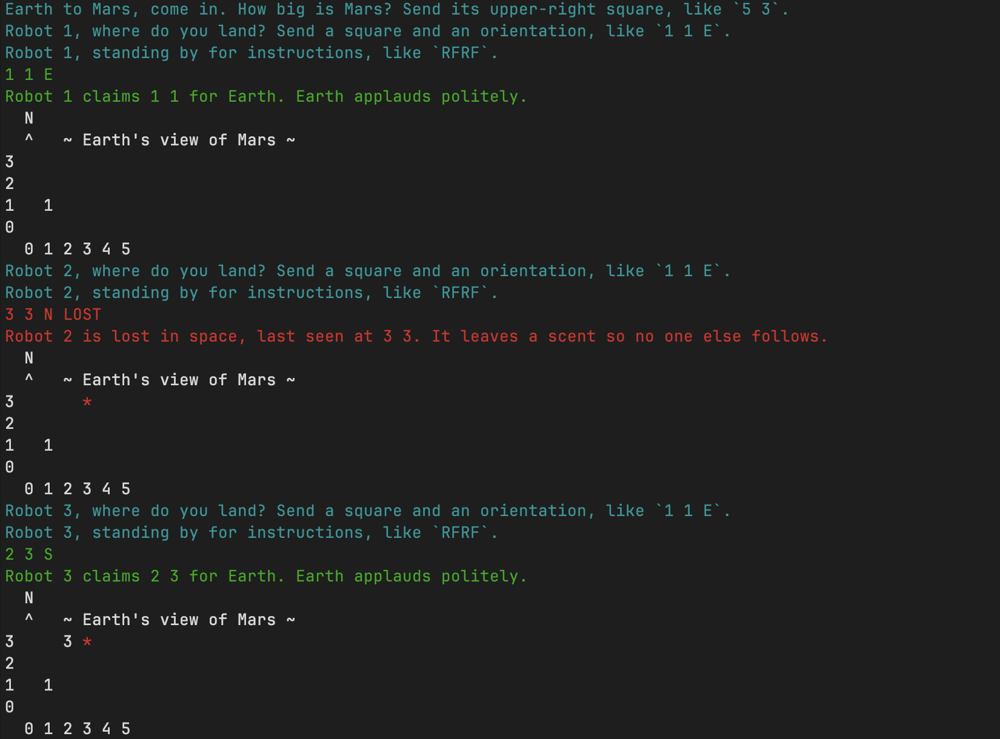

# earth-to-mars

A solution to TDL's Martian Robots challenge (the brief is in [`docs/brief.md`](docs/brief.md)). Earth sends robots to Mars, a bounded rectangle of squares, and the program reports where each one ends up. It is a .NET 10 console app.

## How to run it

You need the [.NET 10 SDK](https://dotnet.microsoft.com/download/dotnet/10.0) and nothing else; it includes the C# compiler. Run every command from the repo root.

To install it, pick one:

- **The installer** (macOS, Windows): download it from the link above and run it.
- **Microsoft's install script** (macOS, Linux; no package manager or admin rights needed). It installs into `~/.dotnet`, which then goes on your `PATH`:

  ```sh
  curl -sSL -o dotnet-install.sh https://dot.net/v1/dotnet-install.sh
  bash dotnet-install.sh --channel 10.0
  export PATH="$HOME/.dotnet:$PATH"
  ```

  On Windows, the PowerShell equivalent is `dotnet-install.ps1 -Channel 10.0` from `https://dot.net/v1/dotnet-install.ps1`.
- **Homebrew** (macOS): `brew install --cask dotnet-sdk`
- **winget** (Windows): `winget install Microsoft.DotNet.SDK.10`
- **Your distribution's package manager** (Linux): see the [install guide](https://learn.microsoft.com/dotnet/core/install/linux).

From the repo root, `dotnet --version` should then print something like `10.0.401`. The Homebrew cask always installs the newest SDK, and the repo's `global.json` only accepts a 10.0 SDK, so once the cask moves past .NET 10, use one of the other ways instead.

**The brief's sample, through the console app** (bash or zsh):

```sh
dotnet run --project src/MartianRobots.Cli < samples/brief-sample.txt
```

stdout holds exactly the brief's expected output:

```
1 1 E
3 3 N LOST
2 3 S
```

Prompts, Earth-to-Mars messages and a map of Mars after each robot go to stderr, so they show in the terminal but never mix with the result lines. Add `2>/dev/null` to see the bare results only.

**Typing a mission by hand:** run `dotnet run --project src/MartianRobots.Cli` and answer the prompts: Mars's size first, then two lines per robot. Each robot runs as soon as its two lines are in. Ctrl+D ends the mission.

**The tests:**

```sh
dotnet test
```

This runs all the tests, including one that pipes the sample through the console app.

## What it does

The console app is the deliverable. Earth types or pipes in the brief's input, and stdout carries the brief's output, one result line per robot.

On top of the brief, the console app adds a few things that change no rule and never change what stdout carries when it is piped or redirected:

- **Claims.** A robot that finishes its instructions on Mars claims its square for Earth. Each square can be claimed once. When the last unclaimed square is claimed, stderr announces **Mission complete**.
- **The mission map.** After every robot, stderr shows Earth's view of Mars: the claiming robot's number on a claimed square and `*` for a scent. Every other square is an unknown region (one Earth knows nothing about) and is left blank, so only what Earth knows shows up. After the brief's sample:

  ```
    N
    ^   ~ Earth's view of Mars ~
  3     3 *
  2
  1   1
  0
    0 1 2 3 4 5
  ```

- **Colour at a terminal.** On stdout, a result line is green, or red when the robot is lost. On stderr, prompts are cyan; hints and the "stays in the hangar" note are yellow; lost in space is red, claimed green, already claimed yellow and Mission complete magenta; scents are red on the map. Each stream is coloured only when it goes to a terminal, so piped or redirected output stays exactly the brief's text. The brief's sample at a terminal (`dotnet run --project src/MartianRobots.Cli < samples/brief-sample.txt`); the green and red result lines are stdout, everything else is stderr:

  

- **Hints, not crashes.** A bad line gets a hint naming the expected shape, and the same line is asked for again. For example, `1 1 Q` gets "The robot's compass is spinning. Face it N, E, S or W, like `1 1 E`."
- **A mission log.** Every line in and every result line out is appended, with a time, to `logs/missions.txt` under the directory the app runs from. It is write-only and gitignored.

The domain words used here and in the code (Mars, square, position, scent, claim and so on) are defined in [`GLOSSARY.md`](GLOSSARY.md).

## Technical choices

- **.NET 10 and xunit**, pinned in `global.json`. One `dotnet test` from the root runs everything, with no other setup.
- **A core library and a thin console app.** `src/MartianRobots` holds the rules and knows nothing about consoles or HTTP. `src/MartianRobots.Cli` reads stdin and writes stdout and stderr. `src/MartianRobots.Api` is a working first step towards what would come next (see [below](#what-would-be-built-next)). Inside the core, `Domain/` holds the things and the rules (planets, positions, commands, scents, claims), and one folder per process sits beside it: `Missions/` runs robots, `Input/` reads Earth's lines, and `Map/` draws the mission map. [ADR 0002](docs/adr/0002-domain-and-process-folders-in-one-core.md) (an architecture decision record) explains how the core is grouped, and why it isn't split into layers.
- **The core's public surface is small.** There are three line readers (Mars's size, a robot's starting position, its instructions), each returning either the value or a hint. Then a `Mission` that you send robots to, one at a time, which returns a report: the result line, whether the robot was lost, and what it claimed. The tests go through this surface only.
- **An extension point for new command types,** because the brief asks for provision for them. Each command letter (`L`, `R`, `F`) is a small class that proposes the robot's next position, looked up in one letter → command table. The mission, not the command, decides what happens at the edge: it accepts the move, ignores it from a scented square, or loses the robot. So adding a command is one class and one table entry, and a new movement command such as a `B` (back) gets the edge and scent rules for free.
- **An extension point for planets, which the brief doesn't ask for.** `Mars` implements `IPlanet` (its upper-right square, how many squares it has, and whether a square is on it), and the mission, the map and the position reader take any planet. It is there to show extensibility. The map title and the console's messages still say Mars.
- **Nothing else is layered.** The brief asks for "as simple as possible", so there are no repositories, services or dependency-injection setup in the core.
- **stdout is exactly the brief's output.** Everything for a human reader goes to stderr, whether the input is typed or piped. Output can be compared byte for byte, and `2>/dev/null` gives the bare results without a command-line option.

## Approach

1. **Plan before code.** The open questions in the brief were charted as one GitHub issue, [the map](https://github.com/Sam-Archie/earth-to-mars/issues/1), with one child ticket per decision ([#2](https://github.com/Sam-Archie/earth-to-mars/issues/2)–[#8](https://github.com/Sam-Archie/earth-to-mars/issues/8)). Each ticket was settled in its own session and its reasoning is recorded on the ticket. Some decisions were reversed along the way, and the amendments are kept: an early plan failed the whole mission on bad input and stopped running robots at Mission complete, and both were dropped because the brief wants a result line for every robot.
2. **One spec, then build tickets.** The closed map became [one spec](https://github.com/Sam-Archie/earth-to-mars/issues/9), split into build tickets [#10](https://github.com/Sam-Archie/earth-to-mars/issues/10)–[#16](https://github.com/Sam-Archie/earth-to-mars/issues/16). The first ticket got the brief's sample running end to end; each later one added one feature on top.
3. **Test-first, small commits.** Each test was seen failing before the code that passes it. Expected values were worked out by hand from the brief, never computed by the code under test. Each commit holds one behaviour or one decision, and `dotnet test` passes on every commit. `git log` reads as the build story.

## Assumptions

Where the brief leaves something open, these are the calls made.

**Movement and scent**

- A lost robot is reported at the last square it occupied on Mars, followed by `LOST`, and skips the rest of its instructions.
- A scent is tied to the square only, as the brief says ("the same grid point"). It protects that square over any edge: a robot lost off the north edge at `5 3` also stops a later robot falling off the east edge there.
- A robot that *starts* on a scented square is protected by the scent too.
- Robots never block each other. Two robots can stand on the same square.
- An empty instruction line is valid: the robot reports its starting position.
- Robots are numbered from 1 in the order sent, lost ones included.
- Scents and claims last for one mission. Every run starts on a fresh Mars.

**Claims** (additions; no brief rule changes)

- Claiming is automatic when a robot finishes on Mars, not a command. A lost robot claims nothing.
- A robot finishing on a claimed square still gets its normal result line, plus an "already claimed" message on stderr.
- Robots sent after Mission complete still run and still get their result lines, because the brief asks for a line per robot.

**Reading input**

- Input is case-insensitive: `1 1 e` and `rff` are accepted.
- Leading and trailing spaces, tabs and `\r` are trimmed (so Windows line endings work), and any run of spaces or tabs separates the parts of a line.
- Spaces *inside* instructions are rejected: `F F` gets a hint rather than being read as `FF`.
- Numbers are plain digits only, so `+5` and `-1` are rejected as malformed.
- Every x and y is 0 to 50, for Mars's size and for starting positions. A `0 0` Mars is a valid one-square Mars.
- A robot must start on Mars.
- Instructions must be fewer than 100 letters ("less than 100", as the brief says), and every letter must be a known command.
- There is no robot count line; a mission has as many robots as Earth sends.
- The run commands are for bash or zsh only, since the brief names no OS. On Windows, they should work unchanged from Git Bash or WSL (not tested). The console's colours use standard terminal codes; an older Windows console that doesn't understand them may print them as raw text, while Windows Terminal shows them.

**The console app**

- A bad line gets a hint on stderr and the same line is asked for again. It never ends the mission.
- When input is piped, the next line is taken as that retry, so a bad line can shift the lines after it. For example, piping `5 3`, `1 1 Q`, `RF`, `0 0 N`, `F` gives one result, `0 1 N`: `1 1 Q` is rejected, `RF` is then read as a (bad) position, and `0 0 N` + `F` becomes the first robot.
- End of input (Ctrl+D) ends the mission. A robot that has a position but no instructions is dropped, with a note on stderr.
- The app exits 0 whenever input ends, bad lines included. Only a genuine crash exits non-zero.
- The mission log is always on; there is no option to turn it off. It is written as each line happens, so a mission cut short still leaves its record.

## What would be built next

A first step, putting missions behind HTTP, already works in `src/MartianRobots.Api`; ideas 1, 2 and 5 would build on it. It is one `POST /missions` route over the unchanged core: each request is its own mission and gets back result lines only. It can't ask for a line again, so the first bad line, a missing size line or a robot without instructions rejects the whole mission with `400 Bad Request` and a hint. Blank lines are skipped, so a robot with an empty instruction line can't be sent this way. There is no UI, auth or CORS, as the brief rules out a web application. To try it (on port 5050, because macOS's AirPlay Receiver takes the default 5000):

```sh
dotnet run --project src/MartianRobots.Api -- --urls http://localhost:5050
```

Then, in a second terminal:

```sh
curl --data-binary @samples/brief-sample.txt http://localhost:5050/missions
```

The program keeps nothing between missions; ideas 1, 2 and 5 would change that.

1. **An append-only ledger.** Every action stored as a record that is never edited or deleted, and can be read back to trace a mission's history. It would replace today's write-only text log.
2. **Claims kept between missions.** Earth's map of claimed squares would build up over many missions instead of resetting each time.
3. **A game mode.** A fixed-size Mars, robots landing on random squares, sent one at a time.
4. **Live keyboard driving.** Steer one robot with the arrow keys or WASD, each key press sent as one command (`L`, `R` or `F`). This is the worked example of the command seam: it is a third adapter over the same core, and the core would not change.
5. **Scent saved in the API.** Scents carried across requests, so a later request benefits from an earlier robot's loss. It needs a database, and an answer to two requests changing the same Mars at once.

## Deployment

Described, not built: there is no Dockerfile or pipeline here, as the brief asks.

Once missions are behind HTTP, the API would be published as a container image and run on any container host. Because each request is its own mission and nothing is shared, copies scale out behind a load balancer with no coordination, and logging would use the host's normal logging rather than a text file. Saved state (ideas 1, 2 and 5) would change that: every copy would need the same database, and concurrent requests on one Mars would need a rule for who wins.

## How AI was used, and where it wasn't

The work was planned and built with Claude Code, using [Matt Pocock's skills](https://github.com/mattpocock/skills), in this order:

1. **`/wayfinder`** charted [the map](https://github.com/Sam-Archie/earth-to-mars/issues/1) of open decisions, one ticket per decision, using `grilling` and `domain-modeling` to settle each one and write the glossary.
2. **`/to-spec`** turned the closed map into [the spec](https://github.com/Sam-Archie/earth-to-mars/issues/9).
3. **`/to-tickets`** split the spec into build tickets. No code existed before this step.
4. **`/implement`** built one ticket per session, test-first with `tdd`, with `code-review` to check the work against the standards and the spec.

The skills are installed locally and not committed.

**What Claude did:** proposed a recommended answer for every planning question, wrote the code and tests test-first, reviewed its own changes, and drafted this README.

**What was done by hand:**

- Every planning decision. Claude recommended; the human decided.
- Test expected values, worked out from the brief rather than from the code.
- Reviewing every change before it was committed, and editing this README.

**The evidence** is the record itself, not a separate log: [the map](https://github.com/Sam-Archie/earth-to-mars/issues/1), its tickets ([#2](https://github.com/Sam-Archie/earth-to-mars/issues/2)–[#8](https://github.com/Sam-Archie/earth-to-mars/issues/8), then [#10](https://github.com/Sam-Archie/earth-to-mars/issues/10)–[#16](https://github.com/Sam-Archie/earth-to-mars/issues/16)), and [`git log`](https://github.com/Sam-Archie/earth-to-mars/commits/main), where every AI-assisted commit carries a `Co-Authored-By: Claude` trailer.
